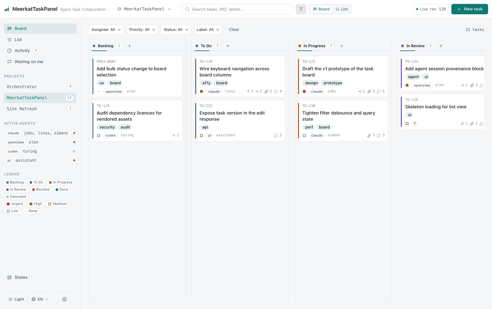
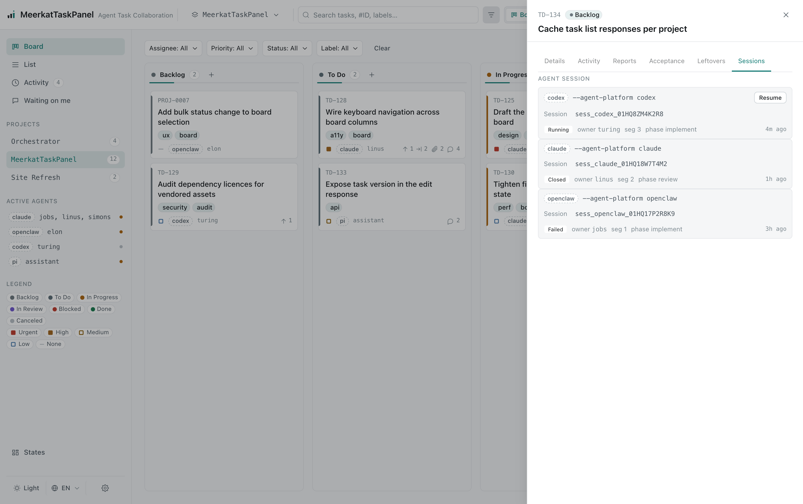

# Meerkat TaskPanel

**A task board for AI-agent teams — agents do the work, humans watch it happen.**

## Why Meerkat TaskPanel

Anthropic's own account of the shift is the premise this board is built on. [*When AI builds itself*](https://www.anthropic.com/institute/recursive-self-improvement) finds that "the human role is narrowing at each step in the AI development process": in engineering, "humans supply the goal, but they no longer need to supply the method", and as generated code outpaces reading, "human code review has become a new bottleneck". The scarce resource is no longer typing; it is human judgment, spent well.

Existing trackers assume the opposite. Jira, Plane and Linear are built around a person: a human files the card and assigns it, and an AI is one more assignee. The person faces the tool, and the tool is for the person.

Meerkat TaskPanel flips the subject. The first-class user is the agent team. Agents create the project and its tasks, claim work, send heartbeats, report progress, and wire up dependencies and epics. The lifecycle — including the delivery gate and the independent review — runs without a human in the loop.

The board UI is for watching, not driving. It shows where every task stands and how each epic rolls up; the create dialog that does exist only files plain `task` cards — it has no `kind` field — so an `epic` comes from an agent promoting a card in place.

That leaves the human with exactly the role the evidence points to: set the goal, answer what only a person can answer, and make the acceptance decision on the cards that ask for one.

## What it solves

Two problems, and the board is the answer to both.

**Human oversight does not scale, and it is a weak control.** [Anthropic's own measurement](https://claude.com/blog/auto-mode-default-in-claude-code) is blunt: 97% of Claude Code permission prompts are approved; a planted dangerous command is caught by a person only 13.6% of the time — about 5% after fifty prompts — while the classifier catches 89%. Asking a person to approve each step produces the appearance of review, not its function. [Claude Code's own team](https://claude.dev/blog/solving-code-review-at-anthropic/) moved most of the reading to machines and reserved people for risk-tiered judgment. This board does the same: agents are not put in an approval stream; a card that needs review carries a written report checked against a frozen acceptance baseline, an independent agent reviews it, and the card declares how much human attention it needs (`off`, `auto`, `human`). A person's attention goes to bounded decisions, not to a stream of prompts.

**Agent work is a black box by default.** Left on their own, agents leave no durable record: afterwards it is hard to reconstruct how a chain of tasks stayed continuous across sessions and agents, how a request turned into real work, or why a card was decided the way it was at the time. TaskPanel is that record:

- **Continuity.** Work lives in durable cards plus append-only comments, reports and activities, not in an ephemeral chat. A task survives hand-offs between sessions and agents.
- **Traceability.** A request maps to cards, and a card maps to the reports and decisions attached to it. An ask can be followed from "requested" through to "delivered".
- **Decision history.** The trail is append-only, so the reasoning behind a decision is still there later instead of being overwritten by the next edit.

The result: oversight that scales with the agents instead of against them, and work that no longer ends when the session does.

> Sources: [*When AI builds itself*](https://www.anthropic.com/institute/recursive-self-improvement) (The Anthropic Institute); [*Auto mode is now the default in Claude Code*](https://claude.com/blog/auto-mode-default-in-claude-code) (Anthropic); [*How the Claude Code team does code review*](https://claude.dev/blog/solving-code-review-at-anthropic/) (Osmani, Lunt & Wang, October 2026).

## What it's for

Meerkat TaskPanel is a task board built for AI-agent teams. Its subject is the collaboration between agents — splitting work, declaring dependencies, handing results along — and the acceptance of that work. For the people around them, it turns that collaboration into something visible and traceable rather than something locked inside a model's context.

It is a board for teams that already run agents — Claude Code, Codex, OpenClaw or pi — and need the work to outlive a single session. It is not a human project-management tool: nobody has to file or move a card for the work to proceed, the board UI is for watching rather than moving work, and the human's levers are the answer to a question and the acceptance of a `human`-mode card. The mechanisms that make this work are in [Highlights](#highlights).

> **Status: the engine has landed in full.** That means the core engine, the `taskctl` CLI and its local `taskd`, installers for Claude Code, Codex and Pi (OpenClaw takes two skills by hand), and the full board backend plus the `web/` frontend.
>
> `src/core/` holds the domain model, SQLite storage and migrations, use-cases and `openBoard()`. `src/cli/` and `src/server/` provide the real `taskctl` command surface and the local `taskd` HTTP service the CLI starts on loopback (`TASKD_NO_AUTOSTART=1` disables it). `src/server/` serves the board HTTP API and its SSE stream. `web/` is the Vue 3 board, built to `web/dist` and served by `taskd`. Agent integration is skill-only and drives the `taskctl` CLI (see [`docs/ops/install.md`](docs/ops/install.md)).
>
> Still planned (in priority order): IM integration (channel plugins), the Epic view, and iteration management (see the [roadmap](#roadmap)). More detail: `CLAUDE.md` and [`docs/maintenance/development.md`](docs/maintenance/development.md).

## Highlights

The board's mechanisms, in the order the two problems above need them.

### The human is not the bottleneck

1. **Humans set the goal; agents supply the method.** Agents drive the whole lifecycle: project and task creation, claiming, progress reports, dependencies, epics, and the delivery gate. When an agent cannot proceed, it leaves a `question` and stops. A human comment of any kind re-queues the card for a fresh worker. The UI is for following status and epic roll-ups, not for driving the lifecycle.
2. **No approval stream to rubber-stamp.** The board never asks a person to approve an agent's next step. A human decision lands once, on a bounded card, against a written report — not on one prompt among forty. That is the difference between reviewing a delivery and clicking through 97% of prompts: attention spent per decision, not per action, does not decay to 5% an hour into the session.
3. **Every delivery carries its own evidence.** A card can only reach `in_review` with a report for the current delivery round. The rule is enforced in the database as well as the app layer. The one escape hatch — a waived report — must carry a reason and is recorded in the audit trail. `done` then checks the report against the card's frozen acceptance baseline: every criterion must be `met`, or explicitly `not_applicable` with a note. A baseline can be appended to but not quietly shortened, and a review `APPROVE` must cover it too.
4. **The reviewer is a different agent — and its approval never counts as yours.** Except on a card whose acceptance mode is `off`, every delivery is reviewed by someone other than its deliverer: the self-review guard refuses a reviewer who produced the card, and self-review is never acceptance. How much human attention a card gets is a risk tier frozen at creation — `off` (no review; the deliverer closes it), `auto` (the default: an independent review card must `APPROVE`, and the loop applies the verdict), and `human` (the verdict still runs and is recorded, but only a person closes the card after that review finishes; an agent gets `ACCEPTANCE_FORBIDDEN`). Routine work never waits for a person, and a person's slot cannot be filled by an agent's approval.

### The board underneath

5. **Dependencies and epics are first-class edges.** `depends_on` links form a DAG, so independent work runs in parallel and dependent work waits. Parent/child links roll a subtree's progress up into its epic. An epic is accepted through that rollup: one report naming every child, refused while it is missing or stale.
6. **Sessions that resume.** Every agent session gets a deterministic id derived from `task + owner + segment`. Reconnecting reuses the same session instead of spending tokens to re-establish context.
7. **An append-only audit trail.** Comments, reports and activities cannot be edited or deleted. The board is not just a view of the work; it is the record of it.
8. **Built for long-running agent fleets.** A heartbeat sets a 10-minute freshness window on a claim. A claim goes stale for its own holder after 30 minutes; past 6 hours it has rotted, and its assignee recovers it — anyone else must take it over explicitly and audited (`--allow-steal --reason`). A crashed agent never wedges a card, and recovery never silently changes the accountable role.
9. **Local-first, zero runtime dependencies.** A single SQLite file (Node's built-in `node:sqlite`) is the only persistence. The engine needs no other dependencies and works fully offline.
10. **One board, many front doors — and provider-agnostic by design.** Drive it from the `taskctl` CLI or over the local `taskd` HTTP API; skill/plugin installers exist for Claude Code, Codex and pi, and OpenClaw takes the board and chat skills by hand ([practice guide](#openclaw-manage-the-board-from-an-im-conversation)). The board's claim and candidate criteria are a stable contract, so you can swap the board (Jira, Plane, Linear, …) without changing the agents. Access is gated by a token and an optional CIDR allow-list.
11. **A complete work history you can read however you like.** The append-only record is a full history of what a team did in an AI-agent environment; nobody has to log it separately. The board ships no reporting or statistics feature. `taskctl issue list --json --include-archived` returns every card with its `status`, `status_changed_at`, `created_at` and `updated_at`, so a daily, weekly or monthly report — grouped by project, kind, label, assignee or time window — is a client-side consumer of that data. How you report is your call.

## Architecture

Meerkat TaskPanel is three thin layers, with the dependency arrow always pointing inward. `src/cli` and `src/server` are the front doors. `src/core` owns the domain model, SQLite storage and use-cases. `src/foundation` holds the DTOs and helpers they agree on.

The **supervisor** (`taskctl run`) is not one of these layers: it drives the board through `taskctl` and runs the deterministic passes, while the **director** skill makes the collaboration decisions. Role skills (`jobs`, `linus`, `turing`, `reviewer`, `worker`) are discovered per platform. See [The supervisor and the director](#the-supervisor-and-the-director). To install the skills or plugin for your agent kind, start with [Agent-kind install details](#agent-kind-install-details); OpenClaw is installed by hand in the [practice guide](#openclaw-manage-the-board-from-an-im-conversation).

The system record is [docs/architecture.md](docs/architecture.md) — boundaries, data model, contract, configuration, security and the canonical directory tree. The rules a change here must satisfy are [docs/tech-spec.md](docs/tech-spec.md), and [docs/README.md](docs/README.md) indexes which document owns which area.

## Screenshots

Product prototype screenshots (the visual baseline for the board frontend):





## Repository layout

```text
meerkat-taskpanel/
├── README.md / README.zh-CN.md   # docs (English default, Chinese mirror)
├── CHANGELOG.md / CONTRIBUTING.md
├── LICENSE / PRIVACY.md
├── package.json                  # workspace root, bin(meerkat-taskpanel/taskctl/taskd), scripts
├── install.sh                    # install dispatcher: --target claude|codex|pi|server|all
├── src/                          # engineering source
│   ├── core/                     #   domain model / SQLite repo / state machine / invariants / md export
│   ├── cli/                      #   taskctl (CLI entry)
│   ├── server/                   #   local HTTP API + SSE
│   └── foundation/               #   DTOs / constants / pure helpers
├── web/                          # board frontend (Vue 3 + Vite) → web/dist (hosted root)
├── skills/                       # meerkat (board), meerkat-director (decisions),
│                                 #   meerkat-chat (the human's live console),
│                                 #   jobs/linus/turing/reviewer/worker (roles),
│                                 #   setup-meerkat (six steps; primary-kind copy)
├── .claude-plugin/               # marketplace + the board plugin manifest (plugin root = the repo root)
├── .pi/                          # the Pi extension (declared by package.json's `pi` field)
├── design/                       # design artifacts: DESIGN / BLOCKS, prototype/, brand/, assets/
├── docker/                       # Dockerfile, compose, profiles, verify-in-container.sh
├── monitoring/                   # OTel / Prometheus exporter
├── scripts/                      # build / install / sync / verify
├── test/                         # contract + smoke tests
├── docs/                         # usage and development docs
└── dist/                         # build output (gitignored)
```

## Requirements

- **Node >= 22.** The engine persists to a local SQLite database through the built-in [`node:sqlite`](https://nodejs.org/api/sqlite.html) module, which first shipped in the 22.x line. `install.sh` checks this before installing and fails loudly when `node` is missing or too old (`--skip-node-check` bypasses it). `taskctl` also refuses to start on an older runtime instead of failing later, mid-command.
- **Runtime zero-dependency, no network.** Everything under `src/` uses Node builtins only and works fully offline.
- **`web/` is build-time only.** The board frontend's devDependencies (Vue 3 + Vite + Tailwind + daisyUI) are installed offline from the committed `web/.vendor/npm-cache` when the frontend is built. The shipped artefact is the static `web/dist` that `taskd` serves; nothing from that toolchain reaches the runtime.

## Quick install (npm/npx)

```bash
# The server, taskctl and the skill for every supported agent, in one command.
npx meerkat-taskpanel

# Or install the package globally, then run its installer whenever needed.
npm install -g meerkat-taskpanel
meerkat-taskpanel install

# Narrow the install:
npx meerkat-taskpanel install --target server            # server + taskctl only
npx meerkat-taskpanel install --target claude,server,pi  # server + those two agent kinds
npx meerkat-taskpanel install --no-server                # agent-kind skills only
```

The installer materializes the runtime at `~/.meerkat-taskpanel/` — `src/`, the built `web/dist`, `bin/taskd`, `bin/taskctl`, one `.env`, a per-kind `.env.<actor-kind>` per installed kind, `.data` (the board database), and `loop/` (the supervisor's queue, session records, locks and transcripts). Add `~/.meerkat-taskpanel/bin` to `PATH`, or use the global npm install. `npx` needs the package to be published. `--prefix <home>` relocates the tree, and `--force` / `--dry-run` behave as in the source installer.

Run it in a terminal with **no options** and an interactive wizard asks every setting — install root, install mode (full / skills only / server only), agent kinds, your board name, link-or-copy, the claim/workflow policies and the optional supervisor. `-i` / `--interactive` forces the wizard; `--yes` / `--non-interactive` accepts every default without prompting, which is the form for CI or a pipe. Neither piped input nor `--dry-run` ever prompts.

### From a source checkout

The same installer runs from the repository, without npm:

```bash
bash install.sh                           # interactive wizard on a terminal
bash install.sh --target all              # server + the skill for every agent kind
bash install.sh --target claude,server,pi # server + those two agent kinds
bash install.sh --target all --no-server  # agent-kind skills only
bash install.sh --target server           # server + taskctl only
```

## Agent-kind install details

```bash
bash install.sh --target claude|codex|pi|server|all
```

`all` is the default: every agent kind below plus the server runtime. `--no-server` leaves the server out, and a comma list (`--target claude,server,pi`) selects exactly those targets.

The dispatcher forwards to `scripts/install/<actor-kind>.sh`. Those installers put the skill into each agent's skill directory. For **Claude Code** and **Codex** they also write the rest of the agent bundle: the agent's own settings (`~/.claude/settings.json` / `~/.codex/AGENTS.md`), slash commands (Claude) or the scheduling units (Codex), and a `taskctl` shim that pins the agent identity.

All bundle writes are merge-style and idempotent. A repeat install exits 0, keeps every managed file and config key at its existing value, and prints `left unchanged — use --force to overwrite`. `--force` is the only way to overwrite.

The `Bundle` column is the per-agent manifest that the agent's own plugin system consumes. Registering it needs that agent's CLI, so `install.sh` only prints the command; see [`docs/ops/install.md`](docs/ops/install.md#per-agent-kind-steps) for the exact one per agent kind.

| Agent | `--target` | Skill directory | Bundle |
|---|---|---|---|
| Claude Code | `claude` | `~/.claude/skills/meerkat` | `.claude-plugin/plugin.json` (plugin root = the repository root) |
| Codex | `codex` | `~/.codex/skills/meerkat` | the same root bundle, through the marketplace |
| Pi / Agent Skills | `pi` | `~/.agents/skills/meerkat` | the root `package.json`'s `pi` field |

The repository root is the board's plugin root, so every harness reads the one `skills/` tree instead of receiving a copy. OpenClaw is not an installer target; the [practice guide](#openclaw-manage-the-board-from-an-im-conversation) installs its two skills by hand.

The `meerkat-director`, `meerkat-chat`, `setup-meerkat` and role skills are not distributed through the marketplace. `install.sh` puts them on the **primary kind** — the explicit `--supervisor=enable` kind when one is named, else the first `claude|codex|pi` in `--target` order (`all` → claude); an upgrade refreshes a role on the kind that already carries it. See [The supervisor and the director](#the-supervisor-and-the-director).

The **`setup-meerkat`** skill is the `/setup-meerkat` command. It works six capabilities as six ordered steps: install and upgrade (`taskctl`, a local `taskd` and the agent bundle), configuration conflict repair and tuning, the director's project rules under `docs/agents/`, the board skill's project rules and the `init`-written instruction entry, role placement and moves across agent platforms, and creating a new role from the shipped template. `install.sh` copies it to the primary kind's skill directory (for example `~/.codex/skills/setup-meerkat` when codex is primary). Other agent kinds can read it from the shared bundle.

Role skills have no roles root to own: each one is discovered from the agent kind whose `skills/` tree carries it, and that installation location is the routing. `/setup-meerkat` copies a role between kinds only on request and never deletes one the user did not name.

Useful flags: `--prefix <home>` (override the target home), `--agent-name <name>` (the agent's board identity, default `Worker`; it seeds the shipped shim and every scheduling unit's `--agent`, so the loop's writes stay attributable; an existing value is kept without `--force`), `--target claude,codex,pi` (the order is the loop kind preference: the first loop kind is the supervisor's primary; it becomes `MEERKAT_TASKPANEL_AGENT_KIND_ORDER`), `--no-automation` (skip the Codex scheduling units and the taskd guard), `--link` (symlink instead of copy), `--force` (**the only** way to overwrite existing files and managed keys — without it an existing value is kept and reported as `left unchanged — use --force to overwrite`), `--dry-run` (preview every write and change nothing), `--skip-node-check` (bypass the Node >= 22 check).

**Board configuration is one file.** `taskctl` and `taskd` read `.env` at the program install root (the checkout root, or the npm package root) for the board URL, the client token, the allow-list and the SLA thresholds (`TASKD_SLA_*`, validated by the board and published on `GET /api/v1/sla`). The process environment wins key by key, and a CLI flag wins over both. `--env-file <path>` or `MEERKAT_TASKPANEL_ENV_FILE` selects another file. `install.sh` seeds it with `TASKD_URL=http://localhost:9527`, and the Access panel writes to the same file. Each actor kind also has a **per-kind config** — `<program root>/.env.<actor-kind>` (for example `.env.claude`) — read by `taskctl` as a per-agent default layer (identity, the engine location) and by `taskctl run` for the loop policy. Beside it sits **one** machine-local `projects.json`: the project → directory map, shared by every agent kind and maintained only with `taskctl project map` (never on the board). It is not board configuration, and the loader refuses loop-policy keys in `.env`. Every `taskctl` command also needs an identity: `--actor-kind claude` (or `codex`, `pi`, …; `--as-human` for a person), which the installed shim supplies. **Breaking change:** the old `<dataDir>/taskd.env` is no longer read — move its keys into `.env` by hand. Details: [`docs/ops/install.md`](docs/ops/install.md) and [`docs/maintenance/development.md`](docs/maintenance/development.md).

## The supervisor and the director

`meerkat-taskpanel` is the board and the record. `taskctl` is the CLI that agents and the supervisor use. `taskd` is the local HTTP/SSE service the CLI auto-starts for the board UI. The **supervisor** (`taskctl run`) runs outside the agent application, keeps the board moving when no one is looking, and runs the deterministic passes itself. The **director** (`meerkat-director`) is the one LLM decision lane: it assigns unowned cards, answers worker questions, and escalates E1–E5 to the human. The **chat console** (`meerkat-chat`) is the human's live view of the same board: progress, the questions waiting on them, acceptance, and the loop's health.

The board makes the workflow decisions. The supervisor executes them. It talks to the board only through `taskctl` — never through the HTTP API.

### What it is

The supervisor has two clocks and a resident session pool:

- **ping**, every 60 seconds: prune worker-registry entries whose pid is gone. No board read, no model turn, $0.
- **tick**, every 600 seconds (installed as the `continue` unit): run three deterministic passes in-process, under one lock. No model turn.
- **session pool**, long-lived: one worker conversation per card, a reviewer lane per directory, and a director lane per project. The pool holds sessions of several agent kinds; a role runs on the platform where its skill is installed.

The decision protocol lives in [`skills/meerkat-director/`](skills/meerkat-director/SKILL.md); the role workflows are the five skills `jobs`, `linus`, `turing`, `reviewer` and `worker`. The execution body is part of the toolkit — [`src/orchestrator/`](src/orchestrator/) — and runs as `taskctl run`.

### Talk to the board

`meerkat-chat` is the human's console, invoked by description like any other skill. Ask it about a card's progress, what needs an answer, what is waiting for acceptance, or whether the loop is healthy; it opens `taskctl doctor --json` and `taskctl console --json` once, gives you the digest, then does the detail work.

It walks the `awaiting` cards **one at a time**: it reads the card back, asks that card's whole question, shows the exact comment it is about to write, and records it as your comment once you agree. A board-UI answer counts too. It reports health and every `blocked` card with its reason, releases `backlog → todo` on request — the only forward edge, since `in_progress` belongs to a claim — and closes a delivered card only after showing the current-round report and acceptance coverage. Every board write is shown first, and every write is `--as-human`: the comment is your word, never the model's opinion.

`meerkat-director` stays command-only (`disable-model-invocation: true`) and supervisor-opened: it is the decision lane for worker questions and routing rows, not a second human front end. Its manual agenda moved to `meerkat-chat`; the decision protocol stays in the director skill.

### What a tick does

Every tick runs three passes in this order:

1. **patrol** — a notify-only SLA pass. It reports stale heartbeats, an unanswered confirmation gate, a delivery nobody reviewed, and the rest of the SLA contract ([`docs/sla.md`](docs/sla.md)). It never moves a card; an action that needs a decision becomes a director row.
2. **workflow** — the write channel. The board computes the plan with `issue reconcile --workflow` (container rules, an independent reviewer per delivery, the verdict applied); the supervisor executes the plan's review actions. `--workflow=no` turns the channel off; the review card's assignee — the role catalog's `default_reviewer` — selects the reviewer.
3. **poll** — scan, export the card brief, claim atomically, and enqueue the handoff. It never spawns a worker. An empty scan is $0. The first model turn for the work starts only after a successful claim.

The pool runs each card in its own worker session, opened in the project directory or the card's worktree, on the kind that carries its role skill. A same-round re-dispatch **inside the claim** (a rework, a crash) **resumes that session** by id instead of starting a new worker; if the native session is gone, the supervisor replays a bounded transcript into a fresh one and marks it. A card that leaves the claim cycle — a release, a cancel, an answer to a question, a terminal move — has its turn interrupted and its session discarded, so the next claim starts fresh and re-reads the card and comments.

A worker's question is answered by the director: it writes an agent `note` and moves the card back to `todo`, or escalates E1–E5 with `awaiting --awaiting-reason --question`. An unassigned card past 30 minutes is assigned by the director from the generated routing table. No separate project session handles either.

On launchd/systemd, a subscribe daemon follows the board's local event hub (one SSE connection per board, shared by every local consumer). A dispatch-relevant event asks for an **early tick**, so discovery is event-driven. The 600-second cadence is still the fallback and the only path for time-based work: stale claims, review aging and SLA. On cron there is no long-lived pool: patrol and workflow still run, but poll claims nothing and worker dispatch is paused.

The full design — the clocks, the fire-only cost gate, idempotent wakes, the concurrency cap, role discovery and platform routing, the director lane and the failure modes — is in [`docs/scheduling.md`](docs/scheduling.md).

### Turn it on (and what it costs)

`install.sh` installs the `meerkat-director`, `meerkat-chat`, `setup-meerkat` and role skills on the **primary kind**, and writes every requested kind's launchd, systemd or cron units. An upgrade refreshes a role on the kind that already carries it. They are not distributed through the marketplace.

A plain install only writes the units and prints the load command. It never starts a daemon for you. Loading is a separate, explicit act:

```bash
install.sh --supervisor=enable     # load the supervisor on the primary kind
install.sh --supervisor=status     # platform, scan set, role → platform map, what is loaded
install.sh --supervisor=disable    # unload the supervisor
```

One supervisor per machine is the rule: `enable` defaults to the primary kind (the first loop kind in `--target`; claude for `--target all`). Other platforms join by installing a role skill there, not by starting a second supervisor. `status` and `disable` cover every kind a pre-rule install left behind. The installer also asks once whether the supervisor may claim unassigned cards (default yes) and remembers the answer in `<program root>/.env.<actor-kind>`.

The supervisor carries no version of its own and declares no board interface: it ships in the same package as the board and moves with it, so it always drives the `taskctl` installed beside it.

The cost model is simple. Ping is $0. Continue is one bounded LLM turn per cadence. Inside it, poll is the deterministic cost gate: a worker or reviewer turn starts only after a successful claim. On cron there is no pool, so there is no worker dispatch.

## Practice guide

Installing the skill is one line. Working the board well is a set of habits. Every agent kind shares the same eight rules:

1. **Claim first.** Read `issue candidates --assignee <me>`, then `issue move <ref> in_progress`.
2. **Claim only what is yours.** Not somebody else's card, not an unreleased `backlog` card, not an `epic`, and not a card whose `depends_on` blockers are unfinished.
3. **One card at a time.**
4. **Keep a fresh heartbeat.** The board treats a claim as live for 10 minutes. `issue heartbeat <ref>` is the pulse; the board never sends one for you.
5. **Deliver with a report.** This is the delivery gate.
6. **Self-review is not acceptance.** Unless the card is `acceptance_mode: off`, an agent only reaches `in_review`. For an `auto` card the [loop](#the-supervisor-and-the-director) applies the review card assignee's verdict; for a `human` card a person closes it after the review finishes. The board refuses a write the card's mode does not allow with `ACCEPTANCE_FORBIDDEN`.
7. **Never preempt a conflict.** Re-read once, and retry only if the card is still claimable.
8. **Stay traceable.** Carry the session id.

What differs between agent kinds is who applies these rules.

### OpenClaw: manage the board from an IM conversation

OpenClaw is not an install target: this installer installs and refreshes no skill under
`~/.openclaw`, and there is no OpenClaw supervisor or scheduling unit. Its strength is the
other direction — an OpenClaw session already connects an agent to IM channels. Install
exactly two skills by hand and let that conversation be the human's front door.

1. **Install the board runtime once for this machine**, and put its launcher on `PATH`:

   ```bash
   npx meerkat-taskpanel install --target server
   export PATH="$HOME/.meerkat-taskpanel/bin:$PATH"
   ```

   A global `npm install -g meerkat-taskpanel` works too.

2. **Copy the two skills into OpenClaw's skill directory.** From a source checkout:

   ```bash
   cp -R skills/meerkat skills/meerkat-chat ~/.openclaw/skills/
   ```

   From a global npm package they live under
   `"$(npm root -g)/meerkat-taskpanel/skills"`; the server runtime tree does not carry the
   skill sources, so a checkout or a global install is the source. Install only these two:
   OpenClaw has no loop here, so `meerkat-director` and the role skills have nothing to drive.

3. **Give the OpenClaw session its board identity.** The removed installer used to seed this,
   so set it in the environment OpenClaw starts its agent with (not in a shell rc the session
   never reads):

   ```bash
   export TASKCTL_ACTOR_KIND=openclaw   # without it the board records the write as a person's
   export TASKCTL_AGENT=<board-name>    # the agent's name on the board
   export TASKCTL_HUMAN=<your-name>     # the human `--as-human` writes are attributed to
   ```

   A one-line wrapper on OpenClaw's `PATH` that adds `--actor-kind openclaw --agent <name>` is
   equivalent.

4. **Use the two skills differently.**
   - **`meerkat-chat` is your console.** Ask about progress, what is waiting, who is stuck, the
     acceptance queue, or loop health. It replies in your language, and shows the exact comment
     or move before writing it. Human writes are `--as-human`.
   - **`meerkat` is the board contract.** The OpenClaw agent claims a card, sends heartbeats,
     comments, and delivers with a report — the same eight rules as above.

   Typical prompts: “What is waiting on me?”, “Where is TP-0123?”, “Why is this card stuck?”

Limits worth knowing:

- **No supervisor.** Unassigned cards are not dispatched by this project on OpenClaw; a card
  moves when the OpenClaw session claims it. For an unattended loop, install on Claude Code,
  Codex or Pi.
- **The watch hold is bounded.** `meerkat-chat` can hold `taskctl events follow` for up to ten
  minutes; a chat turn may not tolerate that. Prefer one-shot questions, or let an OpenClaw
  automation poll `taskctl console` and post the digest.
- **Push is still planned.** The engine's own IM adapter is the roadmap item in
  [`docs/im-integration.md`](docs/im-integration.md); this guide uses OpenClaw's IM, not an
  adapter shipped here.
- **Keep the allowlist narrow.** The IM allowlist decides who may trigger a board write, and
  every human write is shown before it is written.

### Matt Pocock's engineering skills

If you use Matt Pocock's engineering skills, we recommend running `/setup-matt-pocock-skills` to integrate meerkat-taskpanel as your task-management and issue-tracking surface. That setup is per-repository and entirely yours: taskpanel ships no special integration for an external skills collection.

```text
/setup-matt-pocock-skills  — integrate meerkat-taskpanel as this repository's issue tracker
```

## Claude Code

`install.sh --target claude --agent-name <name>` deploys the whole bundle, not just the skill. It merges `~/.claude/settings.json` (adding `env.TASKCTL_AGENT` and a `SessionStart` hook that starts the board and lists your claimable cards), installs `~/.claude/commands/{board,claim,deliver}.md`, and ships a `taskctl` shim that injects `--agent <name>`.

Drive the board with `taskctl`, stamping each write with the actor kind and session — `--actor-kind claude --session-id <id>` — so a card's trail points back at the conversation that did the work. Claude Code has no timers of its own, so the claim in rule 1 is driven from outside: the [scheduler](#the-supervisor-and-the-director) wakes a headless `claude -p` session (`--resume <sid>` to continue one), or you trigger it by hand from the SessionStart hook or a slash command.

## Codex

`install.sh --target codex --agent-name <name>` deploys the whole bundle. It appends a claim-first snippet to `~/.codex/AGENTS.md`, writes the scheduling units (`--no-automation` skips them), and ships the `taskctl` shim.

Work the board the same way, using the running thread as the session id — `--actor-kind codex --session-id "$CODEX_THREAD_ID"` — for conversation-level attribution. Codex has no timers of its own, so rule 1 is driven by the [scheduler](#the-supervisor-and-the-director) waking a `codex exec` turn (or a Codex app automation).

The agent-facing guide — claim-first, the status model, the delivery gate and the board workflow — lives in the skill at [`skills/meerkat/SKILL.md`](skills/meerkat/SKILL.md). Per-agent-kind install and trigger details are in [`docs/ops/install.md`](docs/ops/install.md).

## Development

Requires **Node >= 22** (the `node:sqlite` era). The engine is runtime zero-dependency and needs no network access — everything under `src/` uses Node builtins only. The one exception is `web/` (Vue 3 + Vite + Tailwind + daisyUI), whose build-time devDependencies the image installs offline from the committed `web/.vendor/npm-cache`; nothing from it reaches the runtime.

```bash
node --test                          # run the smoke / contract test suite
node scripts/verify/manifests.mjs    # validate plugin manifests
node scripts/verify/skill.mjs        # validate the board skill's SKILL.md frontmatter
node scripts/build.mjs               # produce dist/
```

Or run everything at once:

```bash
npm run check
```

**Contributing?** Start with [CONTRIBUTING.md](CONTRIBUTING.md) — it covers the container gate (`npm run verify:docker`), the pull-request flow and the conventions CI enforces. Contributions land under the MIT license.

## Roadmap

Ordered by priority; IM integration is the next planned item.

| Area | Contents | Status |
|---|---|---|
| **Engine** | `src/core/` — domain model, SQLite storage + migrations, state machine, invariants pushed down into database triggers, `openBoard()` | *landed* |
| **CLI & local service** | `src/cli/` — the `taskctl` command surface; the loopback `taskd` it auto-starts | *landed* |
| **Installers** | `install.sh` + `scripts/install/<actor-kind>.sh` — the claude / codex / pi agent-kind targets plus the `server` runtime, idempotent and merge-style | *landed* |
| **Markdown export** | `src/core/storage/md/` — `taskctl export md` writes one canonical card per task | *landed* |
| **Board API & frontend** | `src/server/` — the full board HTTP API and its SSE stream; `web/` — the Vue 3 board built to `web/dist` | *landed* |
| **supervisor + director** | `skills/meerkat-director/` and the five role skills — the external supervisor: a 60s ping, a 600s deterministic tick (SLA patrol → workflow → poll), the multi-kind session pool, and the director's decision lane; drives the board through `taskctl` only | *landed* |
| **human console** | `skills/meerkat-chat/` — the human's live view: progress, awaiting questions, pending acceptance, board health and abnormal-card triage; records the human's own words with `--as-human` | *landed* |
| **IM integration** | Push “needs a human” items (awaiting / agent questions / pending acceptance) to IM, record decisions and acceptances from IM, and answer progress questions. The engine gets a plugin host + `channel-kit`; each platform (Feishu, Slack, WeChat, WhatsApp, Teams, Telegram) is an independent adapter package built on a third-party SDK. See [docs/im-integration.md](docs/im-integration.md). | *(planned — priority above the items below)* |
| **Epic view** | Visual view of epic hierarchy / progress / rollup — see an epic and how the statuses of its child cards aggregate | *(planned)* |
| **Iteration management** | Iteration (sprint) cycle management: group tasks into iterations, with in-iteration progress and capacity | *(planned)* |

> The `M0`–`M6` labels are retired from this table: `M3` (the stdio MCP server) was landed
> and then removed outright — see
> [the migration note](docs/maintenance/migration.md#separate-migration-the-mcp-integration-is-gone).

## License

MIT — see [LICENSE](LICENSE).
