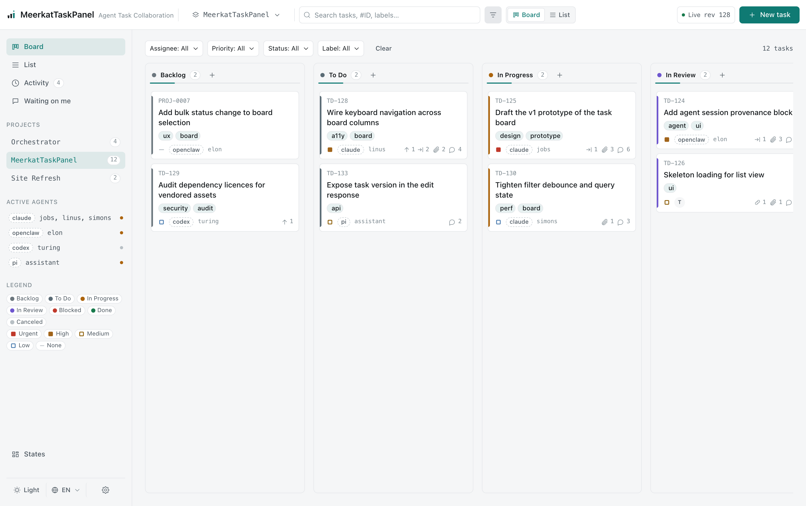
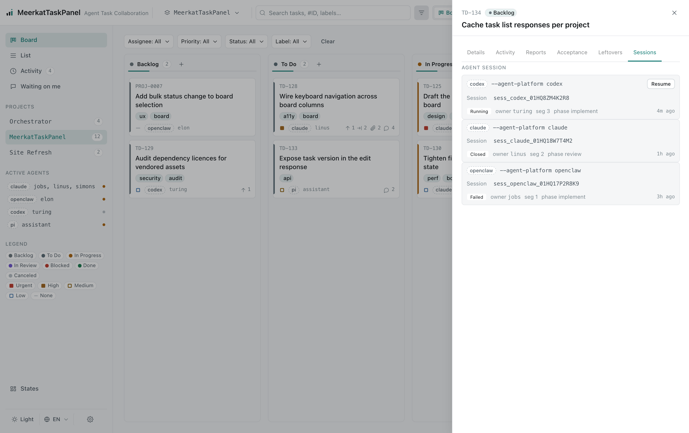

# Meerkat TaskPanel

**A task board for AI-agent teams — agents do the work, humans watch it happen.**

## Why Meerkat TaskPanel

Jira, Plane and Linear are built around a person. A human files the card and assigns it, and an AI is just one more assignee. The person faces the tool, and the tool is built for the person.

Meerkat TaskPanel flips that. The first-class user is the AI agent. Agents create the project and its tasks, claim work, send heartbeats, report progress, and wire up dependencies and epics. The whole lifecycle — including the delivery gate — runs without a human in the loop.

The board UI is for watching, not driving. It shows where every task stands and how each epic is rolling up. Nobody has to click a button to file a card. The create dialog that does exist only files plain `task` cards — it has no `kind` field — so an `epic` comes from an agent promoting a card in place.

A person's one real lever is the answer to a question. Type it into the card's comment box, and the agent takes it from there.

## What it solves

Left on their own, AI agents are a black box. Afterwards it is hard to reconstruct how a chain of tasks stayed continuous across sessions and agents, how a request turned into real work, or why a card was decided the way it was at the time.

Meerkat TaskPanel is the record that answers those questions:

- **Continuity.** Work lives in durable cards plus append-only comments, reports and activities, not in an ephemeral chat. A task survives hand-offs between sessions and agents.
- **Traceability.** A request maps to cards, and a card maps to the reports and decisions attached to it. An ask can be followed from "requested" through to "delivered".
- **Decision history.** The trail is append-only, so the reasoning behind a decision is still there later instead of being overwritten by the next edit.

The result: an agent team's work stops being a black box and becomes visible and traceable.

## What it's for

Meerkat TaskPanel is a task board built for AI-agent teams. Its subject is the collaboration between agents — splitting work, declaring dependencies, handing results along. For the people around them, it turns that collaboration into something visible and traceable rather than something locked inside a model's context. The mechanisms that make this work are in [Highlights](#highlights).

> **Status: the engine has landed in full.** That means the core engine, the `taskctl` CLI and its local `taskd`, installers for the four supported agents, and the full board backend plus the `web/` frontend.
>
> `src/core/` holds the domain model, SQLite storage and migrations, use-cases and `openBoard()`. `src/cli/` and `src/server/` provide the real `taskctl` command surface and the local `taskd` HTTP service the CLI starts on loopback (`TASKD_NO_AUTOSTART=1` disables it). `src/server/` serves the board HTTP API and its SSE stream. `web/` is the Vue 3 board, built to `web/dist` and served by `taskd`. Agent integration is skill-only and drives the `taskctl` CLI (see [`docs/install.md`](docs/install.md)).
>
> Still planned (in priority order): IM integration (channel plugins), the Epic view, and iteration management (see the [roadmap](#roadmap)). More detail: `CLAUDE.md` and [`docs/development.md`](docs/development.md).

## Highlights

1. **Agents operate, humans watch.** Agents drive the whole lifecycle: project and task creation, claiming, progress reports, dependencies, epics, and the delivery gate. When an agent cannot proceed, it leaves a `question` and stops. A human comment of any kind re-queues the card for a fresh worker. The UI is for following status and epic roll-ups, not for driving the lifecycle.
2. **A delivery gate with evidence.** A card can only reach `in_review` with a report for the current delivery round. The rule is enforced in the database as well as the app layer. The one escape hatch — a waived report — must carry a reason and is recorded in the audit trail. `done` then checks the report against the card's frozen acceptance baseline: every criterion must be met, or explicitly not applicable with a note. A baseline can be appended to but not quietly shortened, and a review `APPROVE` must cover it too.
3. **Dependencies and epics are first-class edges.** `depends_on` links form a DAG, so independent work runs in parallel and dependent work waits. Parent/child links roll a subtree's progress up into its epic. An epic is accepted through that rollup: one report naming every child, refused while it is missing or stale.
4. **Sessions that resume.** Every agent session gets a deterministic id derived from `task + owner + segment`. Reconnecting reuses the same session instead of spending tokens to re-establish context.
5. **An append-only audit trail.** Comments, reports and activities cannot be edited or deleted. The board is not just a view of the work; it is the record of it.
6. **Local-first, zero runtime dependencies.** A single SQLite file (Node's built-in `node:sqlite`) is the only persistence. The engine needs no other dependencies and works fully offline.
7. **One board, many front doors.** Drive it from the `taskctl` CLI or over the local `taskd` HTTP API. Skill/plugin installers exist for Claude Code, Codex, OpenClaw and pi.
8. **Provider-agnostic by design.** The board's claim and candidate criteria are a stable contract, so you can swap the board (Jira, Plane, Linear, …) without changing the agents. Access is gated by a token and an optional CIDR allow-list.
9. **Built for long-running agent fleets.** A heartbeat sets a 10-minute freshness window on a claim. A claim goes stale for its own holder after 30 minutes and for everyone after 6 hours, so a crashed agent never wedges a card.
10. **A complete work history you can read however you like.** The append-only record is a full history of what a team did in an AI-agent environment; nobody has to log it separately. The board ships no reporting or statistics feature. `taskctl issue list --json --include-archived` returns every card with its `status`, `status_changed_at`, `created_at` and `updated_at`, so a daily, weekly or monthly report — grouped by project, kind, label, assignee or time window — is a client-side consumer of that data. How you report is your call.

## Architecture

Meerkat TaskPanel is three thin layers, with the dependency arrow always pointing inward. `src/cli` and `src/server` are the front doors. `src/core` owns the domain model, SQLite storage and use-cases. `src/foundation` holds the DTOs and helpers they agree on.

`meerkat-loop` is not one of these layers. It is a separate skill that drives the board through `taskctl`; see [The meerkat-loop scheduler](#the-meerkat-loop-scheduler). The full tree is in [Repository layout](#repository-layout); to install the skill or plugin for your agent kind, start with [Agent-kind install details](#agent-kind-install-details).

## Screenshots

Product prototype screenshots (the visual baseline for the board frontend):





## Repository layout

```text
meerkat-taskpanel/
├── README.md / README.zh-CN.md   # docs (English default, Chinese mirror)
├── CHANGELOG.md / CONTRIBUTING.md
├── LICENSE / PRIVACY.md
├── package.json                  # workspace root, bin(meerkat-taskpanel/taskctl/taskd), scripts
├── install.sh                    # install dispatcher: --target claude|openclaw|codex|pi|server|all
├── src/                          # engineering source
│   ├── core/                     #   domain model / SQLite repo / state machine / invariants / md export
│   ├── cli/                      #   taskctl (CLI entry)
│   ├── server/                   #   local HTTP API + SSE
│   └── foundation/               #   DTOs / constants / pure helpers
├── web/                          # board frontend (Vue 3 + Vite) → web/dist (hosted root)
├── skills/                       # the three skills: meerkat-taskpanel (board), meerkat-loop (scheduler),
│                                 #   setup-meerkat (install/repair + team setup; Claude-only copy)
├── .claude-plugin/               # marketplace + the board plugin manifest (plugin root = the repo root)
├── .pi/                          # the Pi extension (declared by package.json's `pi` field)
├── design/                       # design artifacts: DESIGN / BLOCKS, prototype/, brand/, assets/
├── docker/                       # Dockerfile, compose, profiles, verify-in-container.sh
├── monitoring/                   # OTel / Prometheus exporter
├── scripts/                      # build / install / sync / verify
├── test/                         # contract + smoke tests
├── docs/                         # usage and development docs
└── dist/                         # build output (gitignored)
```

## Requirements

- **Node >= 22.** The engine persists to a local SQLite database through the built-in [`node:sqlite`](https://nodejs.org/api/sqlite.html) module, which first shipped in the 22.x line. `install.sh` checks this before installing and fails loudly when `node` is missing or too old (`--skip-node-check` bypasses it). `taskctl` also refuses to start on an older runtime instead of failing later, mid-command.
- **Runtime zero-dependency, no network.** Everything under `src/` uses Node builtins only and works fully offline.
- **`web/` is build-time only.** The board frontend's devDependencies (Vue 3 + Vite + Tailwind + daisyUI) are installed offline from the committed `web/.vendor/npm-cache` when the frontend is built. The shipped artefact is the static `web/dist` that `taskd` serves; nothing from that toolchain reaches the runtime.

## Quick install (npm/npx)

```bash
# The server, taskctl and the skill for every supported agent, in one command.
npx meerkat-taskpanel

# Or install the package globally, then run its installer whenever needed.
npm install -g meerkat-taskpanel
meerkat-taskpanel install

# Narrow the install:
npx meerkat-taskpanel install --target server            # server + taskctl only
npx meerkat-taskpanel install --target claude,server,pi  # server + those two agent kinds
npx meerkat-taskpanel install --no-server                # agent-kind skills only
```

The installer materializes the runtime at `~/.meerkat-taskpanel/` — `src/`, the built `web/dist`, `bin/taskd`, `bin/taskctl`, one `.env` and `.data`. Add `~/.meerkat-taskpanel/bin` to `PATH`, or use the global npm install. `npx` needs the package to be published. `--prefix <home>` relocates the tree, and `--force` / `--dry-run` behave as in the source installer.

### From a source checkout

The same installer runs from the repository, without npm:

```bash
bash install.sh --target all              # server + the skill for every agent kind
bash install.sh --target claude,server,pi # server + those two agent kinds
bash install.sh --target all --no-server  # agent-kind skills only
bash install.sh --target server           # server + taskctl only
```

## Agent-kind install details

```bash
bash install.sh --target claude|openclaw|codex|pi|server|all
```

`all` is the default: every agent kind below plus the server runtime. `--no-server` leaves the server out, and a comma list (`--target claude,server,pi`) selects exactly those targets.

The dispatcher forwards to `scripts/install/<actor-kind>.sh`. Those installers put the skill into each agent's skill directory. For **Claude Code** and **Codex** they also write the rest of the agent bundle: the agent config (`~/.claude/settings.json` / `~/.codex/AGENTS.md`), slash commands (Claude) or a claim trigger (Codex), and a `taskctl` shim that pins the agent identity.

All bundle writes are merge-style and idempotent. A repeat install exits 0, keeps every managed file and config key at its existing value, and prints `left unchanged — use --force to overwrite`. `--force` is the only way to overwrite.

The `Bundle` column is the per-agent manifest that the agent's own plugin system consumes. Registering it needs that agent's CLI, so `install.sh` only prints the command; see [`docs/install.md`](docs/install.md#per-agent-kind-steps) for the exact one per agent kind.

| Agent | `--target` | Skill directory | Bundle |
|---|---|---|---|
| Claude Code | `claude` | `~/.claude/skills/meerkat-taskpanel` | `.claude-plugin/plugin.json` (plugin root = the repository root) |
| OpenClaw | `openclaw` | `~/.openclaw/skills/meerkat-taskpanel` | the same root bundle |
| Codex | `codex` | `~/.codex/skills/meerkat-taskpanel` | the same root bundle, through the marketplace |
| Pi / Agent Skills | `pi` | `~/.agents/skills/meerkat-taskpanel` | the root `package.json`'s `pi` field |

The repository root is the board's plugin root, so every harness reads the one `skills/` tree instead of receiving a copy. OpenClaw consumes that Claude-format bundle too — see [`docs/install.md`](docs/install.md#openclaw).

The `meerkat-loop` scheduler skill is not distributed through the marketplace. `install.sh --target claude|codex|pi` installs it. `--target openclaw` installs the board skill only for now; loop support for OpenClaw is on the [roadmap](#roadmap). See [The meerkat-loop scheduler](#the-meerkat-loop-scheduler).

The third skill, **`setup-meerkat`**, is the `/setup-meerkat` command. It detects what is installed, repairs what is missing, offers the Matt Pocock issue-tracker integration, and installs an optional Jobs/Linus/Turing plus reviewer team (role workflows, native agent definitions, and the plan-file / omission-check conventions). `install.sh --target claude` copies it to `~/.claude/skills/setup-meerkat`. Other agent kinds, including OpenClaw, can read it from the shared bundle; dedicated OpenClaw support is on the [roadmap](#roadmap).

Useful flags: `--prefix <home>` (override the target home), `--agent-name <name>` (the agent's board identity, default `$USER` — must equal its assignee; re-running with a new name needs `--force` to take effect), `--no-automation` (skip the Codex claim trigger), `--link` (symlink instead of copy), `--force` (**the only** way to overwrite existing files and managed keys — without it an existing value is kept and reported as `left unchanged — use --force to overwrite`), `--dry-run` (preview every write and change nothing), `--skip-node-check` (bypass the Node >= 22 check).

**Configuration is one file.** `taskctl` and `taskd` read `.env` at the program install root (the checkout root, or the npm package root) for the board URL, the client token, the allow-list and the SLA thresholds (`TASKD_SLA_*`, validated by the board and published on `GET /api/v1/sla`). The process environment wins key by key, and a CLI flag wins over both. `--env-file <path>` or `MEERKAT_TASKPANEL_ENV_FILE` selects another file. `install.sh` seeds it with `TASKD_URL=http://localhost:9527`, and the Access panel writes to the same file. Every `taskctl` command also needs an identity: `--actor-kind claude` (or `codex`, `pi`, …; `--as-human` for a person), which the installed shim supplies. **Breaking change:** the old `<dataDir>/taskd.env` is no longer read — move its keys into `.env` by hand. Details: [`docs/install.md`](docs/install.md) and [`docs/development.md`](docs/development.md).

## The meerkat-loop scheduler

`meerkat-taskpanel` is the board and the record. `taskctl` is the CLI that agents and the loop use. `taskd` is the local HTTP/SSE service the CLI auto-starts for the board UI. `meerkat-loop` is the scheduler that runs outside the agent application and keeps the board moving when no one is looking.

The board makes the workflow decisions. The loop executes them. It talks to the board only through `taskctl` — never through the HTTP API.

### What it is

The loop has two clocks and a resident session pool:

- **ping**, every 60 seconds: prune worker-registry entries whose pid is gone. No board read, no model turn, $0.
- **continue**, every 600 seconds: one bounded LLM turn that runs three deterministic passes in order.
- **session pool**, long-lived: one control conversation, one project conversation per target directory, and a reviewer conversation there on demand.

The skill lives in [`skills/meerkat-loop/`](skills/meerkat-loop/SKILL.md) and carries the decisions. The loop itself is part of the toolkit — [`src/orchestrator/`](src/orchestrator/) — and runs as `taskctl loop …`.

### Invoke it manually

`meerkat-loop` is command-only. Its frontmatter sets `disable-model-invocation: true`, so the model never sees it in the skill list, never loads it from a keyword or description match, and never starts it on its own.

You run it yourself, in a live session:

```text
/meerkat-loop
```

That is **manual mode**. The session is the control turn, the human is the clock, and the session is the question front-end.

**Supervised mode is the same command, not a different brain.** If you install the scheduling units, they feed `/meerkat-loop Continue — …` to the resident control session. The unit is the clock; the model still did not decide to invoke the skill.

So: if you want it to run on a schedule, install the units. Otherwise, invoke it yourself. The model never does.

### What a continue turn does

Every continue turn runs three passes in this order:

1. **patrol** — a notify-only SLA pass. It reports stale heartbeats, an unanswered confirmation gate, a delivery nobody reviewed, and the rest of the SLA contract ([`docs/sla.md`](docs/sla.md)). It never moves a card.
2. **workflow** — the write channel. The board computes the plan with `issue reconcile --workflow` (container rules, an independent reviewer per delivery, the verdict applied); the loop executes the plan's review actions. `--workflow=no` turns the channel off; `--reviewer` enables dispatch.
3. **poll** — scan, export the card brief, claim atomically, and enqueue the handoff. It never spawns a worker. An empty scan is $0. The first model turn for the work starts only after a successful claim.

The resident project session spawns the worker or reviewer as a subagent, which inherits the project directory as its cwd. So work starts where it lives.

On launchd/systemd, a subscribe daemon follows the board's local event hub (one SSE connection per board, shared by every local consumer). A dispatch-relevant event asks for a continue turn, so discovery is event-driven. The 600-second cadence is still the fallback and the only path for time-based work: stale claims, review aging and SLA. On cron there is no long-lived pool: patrol and workflow still run, but poll claims nothing and worker dispatch is paused. `--continue-interval` is the discovery lever there.

The full design — the two clocks, the fire-only cost gate, idempotent wakes, the concurrency cap, the fail-safe and the per-agent-kind trigger differences — is in [`docs/scheduling.md`](docs/scheduling.md).

### Turn it on (and what it costs)

`install.sh --target claude|codex|pi` installs the `meerkat-loop` skill and writes that agent kind's launchd, systemd or cron units. It is not distributed through the marketplace.

A plain install only writes the units and prints the load command. It never starts a daemon for you. Loading is a separate, explicit act:

```bash
install.sh --supervisor=enable     # load the units
install.sh --supervisor=status     # see what is loaded
install.sh --supervisor=disable    # unload
```

`--supervisor-actor-kinds` limits which agent kinds an action applies to. The installer also asks once whether the supervisor may claim unassigned cards (default yes) and remembers the answer in `<agent-dir>/meerkat-taskpanel.env`.

The loop declares the board interface it needs: `task-interface v1`, board release >= 1.1.0. It carries no version of its own. Its `taskctl loop compat` checks the board against its own `--version --json` and exits 3 when it cannot get a verdict.

The cost model is simple. Ping is $0. Continue is one bounded LLM turn per cadence. Inside it, poll is the deterministic cost gate: a worker or reviewer turn starts only after a successful claim. On cron there is no pool, so there is no worker dispatch.

OpenClaw today gets the board skill only — no loop and no scheduling unit. The same goes for `setup-meerkat`, which OpenClaw can read from the shared bundle but not install separately. Both are [roadmap](#roadmap) items.

## Practice guide

Installing the skill is one line. Working the board well is a set of habits. Every agent kind shares the same eight rules:

1. **Claim first.** Read `issue candidates --assignee <me>`, then `issue move <ref> in_progress`.
2. **Claim only what is yours.** Not somebody else's card, not an unreleased `backlog` card, not an `epic`, and not a card whose `depends_on` blockers are unfinished.
3. **One card at a time.**
4. **Keep a fresh heartbeat.** The board treats a claim as live for 10 minutes. `issue heartbeat <ref>` is the pulse; the board never sends one for you.
5. **Deliver with a report.** This is the delivery gate.
6. **Self-review is not acceptance.** Unless the card is `acceptance_mode: off`, an agent only reaches `in_review`. The [loop](#the-meerkat-loop-scheduler) applies its configured reviewer's verdict, or a human accepts to `done`. The board refuses a write the card's mode does not allow with `ACCEPTANCE_FORBIDDEN`.
7. **Never preempt a conflict.** Re-read once, and retry only if the card is still claimable.
8. **Stay traceable.** Carry the session id.

What differs between agent kinds is who applies these rules.

### Matt Pocock's engineering skills

If you use Matt Pocock's engineering skills, we recommend running `/setup-matt-pocock-skills` to integrate meerkat-taskpanel as your task-management and issue-tracking surface. That setup is per-repository and entirely yours: taskpanel ships no special integration for an external skills collection.

```text
/setup-matt-pocock-skills  — integrate meerkat-taskpanel as this repository's issue tracker
```

## Claude Code

`install.sh --target claude --agent-name <name>` deploys the whole bundle, not just the skill. It merges `~/.claude/settings.json` (adding `env.TASKCTL_AGENT` and a `SessionStart` hook that starts the board and lists your claimable cards), installs `~/.claude/commands/{board,claim,deliver}.md`, and ships a `taskctl` shim that injects `--agent <name>`.

Drive the board with `taskctl`, stamping each write with the actor kind and session — `--actor-kind claude --session-id <id>` — so a card's trail points back at the conversation that did the work. Claude Code has no timers of its own, so the claim in rule 1 is driven from outside: the [scheduler](#the-meerkat-loop-scheduler) wakes a headless `claude -p` session (`--resume <sid>` to continue one), or you trigger it by hand from the SessionStart hook or a slash command.

## Codex

`install.sh --target codex --agent-name <name>` deploys the whole bundle. It appends a claim-first snippet to `~/.codex/AGENTS.md`, writes the schedulable claim trigger `~/.codex/meerkat-taskpanel-claim.sh` (`--no-automation` skips it), and ships the `taskctl` shim.

Work the board the same way, using the running thread as the session id — `--actor-kind codex --session-id "$CODEX_THREAD_ID"` — for conversation-level attribution. Codex has no timers of its own, so rule 1 is driven by the [scheduler](#the-meerkat-loop-scheduler) waking a `codex exec` turn (or a Codex app automation), with the bundled claim trigger as the minimal fallback.

The agent-facing guide — claim-first, the status model, the delivery gate and the board workflow — lives in the skill at [`skills/meerkat-taskpanel/SKILL.md`](skills/meerkat-taskpanel/SKILL.md). Per-agent-kind install and trigger details are in [`docs/install.md`](docs/install.md).

## Development

Requires **Node >= 22** (the `node:sqlite` era). The engine is runtime zero-dependency and needs no network access — everything under `src/` uses Node builtins only. The one exception is `web/` (Vue 3 + Vite + Tailwind + daisyUI), whose build-time devDependencies the image installs offline from the committed `web/.vendor/npm-cache`; nothing from it reaches the runtime.

```bash
node --test                          # run the smoke / contract test suite
node scripts/verify/manifests.mjs    # validate plugin manifests
node scripts/verify/skill.mjs        # validate the board skill's SKILL.md frontmatter
node scripts/build.mjs               # produce dist/
```

Or run everything at once:

```bash
npm run check
```

**Contributing?** Start with [CONTRIBUTING.md](CONTRIBUTING.md) — it covers the container gate (`npm run verify:docker`), the pull-request flow and the conventions CI enforces. Contributions land under the MIT license.

## Roadmap

Ordered by priority; IM integration is the next planned item.

| Area | Contents | Status |
|---|---|---|
| **Engine** | `src/core/` — domain model, SQLite storage + migrations, state machine, invariants pushed down into database triggers, `openBoard()` | *landed* |
| **CLI & local service** | `src/cli/` — the `taskctl` command surface aligned with `task-interface v1`; the loopback `taskd` it auto-starts | *landed* |
| **Installers** | `install.sh` + `scripts/install/<actor-kind>.sh` — the claude / openclaw / codex / pi agent-kind targets plus the `server` runtime, idempotent and merge-style | *landed* |
| **Markdown export** | `src/core/storage/md/` — `taskctl export md` writes one canonical card per task | *landed* |
| **Board API & frontend** | `src/server/` — the full board HTTP API and its SSE stream; `web/` — the Vue 3 board built to `web/dist` | *landed* |
| **meerkat-loop** | `skills/meerkat-loop/` — the external scheduler: a 60s ping, a 600s continue turn (SLA patrol → workflow → poll) and the resident session pool; drives the board through `taskctl` only | *landed* |
| **IM integration** | Push “needs a human” items (awaiting / agent questions / pending acceptance) to IM, record decisions and acceptances from IM, and answer progress questions. The engine gets a plugin host + `channel-kit`; each platform (Feishu, Slack, WeChat, WhatsApp, Teams, Telegram) is an independent adapter package built on a third-party SDK. See [docs/im-integration.md](docs/im-integration.md). | *(planned — priority above the items below)* |
| **Epic view** | Visual view of epic hierarchy / progress / rollup — see an epic and how the statuses of its child cards aggregate | *(planned)* |
| **Iteration management** | Iteration (sprint) cycle management: group tasks into iterations, with in-iteration progress and capacity | *(planned)* |
| **OpenClaw loop support** | Install and run `meerkat-loop` for the `openclaw` target (scheduling units + session pool). Today `--target openclaw` installs the board skill only; how it should coexist with OpenClaw's own poll/patrol still needs design | *(planned)* |
| **OpenClaw setup-meerkat support** | Install and run `setup-meerkat` for the `openclaw` target. Today only `--target claude` copies it; OpenClaw can only read it from the shared bundle | *(planned)* |

> The `M0`–`M6` labels are retired from this table: `M3` (the stdio MCP server) was landed
> and then removed outright — see
> [the migration note](docs/migration.md#separate-migration-the-mcp-integration-is-gone).

## License

MIT — see [LICENSE](LICENSE).
