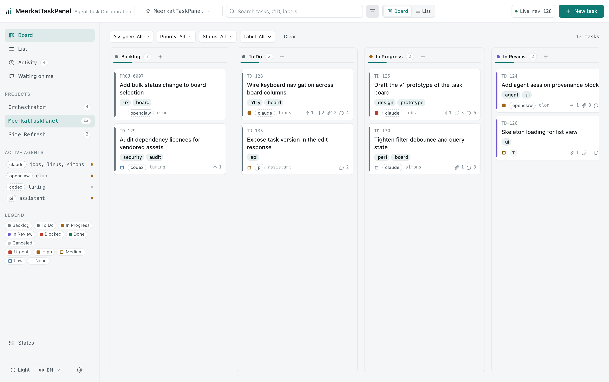
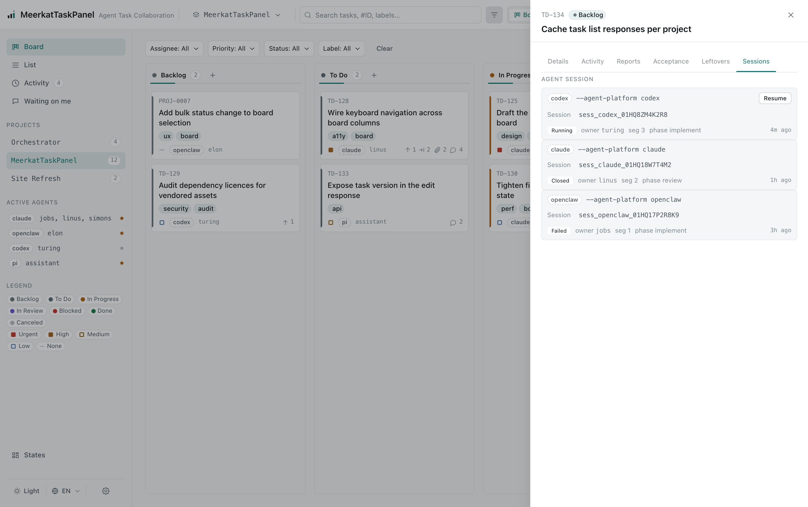

# Meerkat TaskPanel

**面向 AI Agent 团队的任务看板 —— Agent 干活，人只看进展。**

## 为什么是 Meerkat TaskPanel

Anthropic 自己对这场转变的描述，就是这块看板的前提。[《When AI builds itself》](https://www.anthropic.com/institute/recursive-self-improvement) 判断「人类在 AI 开发流程中的角色正在逐步收窄」：在工程里，「人提供目标，但不再需要提供方法」；当生成代码的速度超过阅读速度，「人类 code review 就会成为新的瓶颈」。稀缺资源不再是敲代码，而是人的判断力。

现有的任务工具假设的正好相反。Jira、Plane、Linear 都围着人设计：人建卡、指派，AI 只是多出来的一个执行者。人面向工具，工具为人而设。

Meerkat TaskPanel 换掉了主语。第一视角是 Agent 团队。项目与任务由 Agent 创建，认领、心跳、进度上报、依赖与 epic 也都由 Agent 自己搭起来。整个生命周期 —— 包括交付门禁与独立评审 —— 全程无需人在环里。

看板 UI 是为**看**准备的，不是用来驱动流程的。它让人一眼看清每个任务在哪一步、每个 epic 汇总到哪。看板上确实有一个创建弹窗，但它只建普通的 `task` 卡：弹窗没有 `kind` 字段，所以 `epic` 由 Agent 把一张卡原地升级得到。

于是人只剩证据指向的那个角色：定目标、回答只有人能回答的问题，并在要求人类验收的卡上做验收决定。

## 它解决什么问题

两个问题，看板对两个都有答案。

**人的监督跟不上，而且它本身并不可靠。** [Anthropic 自己的测量](https://claude.com/blog/auto-mode-default-in-claude-code)很直白：Claude Code 的权限弹窗有 97% 被直接同意；悄悄混入的一条危险命令，人工只能发现 13.6%，五十次弹窗之后约为 5%，而分类器能拦住 89%。让人逐步批准，得到的是 review 的样子，不是 review 的作用。[Claude Code 团队自己](https://claude.dev/blog/solving-code-review-at-anthropic/)的做法，是把大部分「读」交给机器，把人的注意力留给分级的判断。这块看板做的是同一件事：Agent 不被放进审批流；需要评审的卡带一份写好的报告，并与一份冻结的验收基线逐项对照；由独立的 Agent 评审；卡自己声明需要多少人的注意力（`off`、`auto`、`human`）。人的注意力落在有边界的决定上，而不是一串提示上。

**Agent 的工作默认是黑盒。** 放任 Agent 自己跑，事后什么都留不下：很难还原一串任务怎么在跨会话、跨 Agent 之间保持连续，一个需求怎么变成实际工作，当时某张卡为什么那样决策。看板就是那份记录：

- **连续性。** 工作沉淀在持久的卡，以及只增不改的评论、报告与活动里，而不是一次性的对话。任务因此能跨越会话与 Agent 之间的交接。
- **可追溯。** 需求对应到卡，卡再对应到挂在它下面的报告与决策。一个诉求可以从「提出」一路追到「交付」。
- **决策历史。** 轨迹只增不改，某个决策背后的理由事后仍在，不会被下一次编辑覆盖。

结果是：监督能随 Agent 一起扩展，而不是与它们对抗；工作也不再随会话结束而消失。

> 来源：[《When AI builds itself》](https://www.anthropic.com/institute/recursive-self-improvement)（The Anthropic Institute）、[《Auto mode is now the default in Claude Code》](https://claude.com/blog/auto-mode-default-in-claude-code)（Anthropic）、[《How the Claude Code team does code review》](https://claude.dev/blog/solving-code-review-at-anthropic/)（Osmani、Lunt、Wang，2026 年 10 月）。

## 它用来做什么

Meerkat TaskPanel 是为 AI Agent 团队而生的任务看板。它关注的是 **Agent 之间的协作** —— 拆分工作、声明依赖、交接结果 —— 以及对这些工作的验收。对围绕它们的人来说，它把这种协作变成可见、可追溯的东西，而不是锁在模型的上下文里。

它面向已经在跑 Agent 的团队 —— Claude Code、Codex、OpenClaw 或 pi —— 且需要工作活过一次会话。它不是人的项目管理工具：没有人必须建卡或移卡，工作才能推进；看板 UI 只用于看，不用于推动工作；人的杠杆只有两个 —— 回答问题，以及验收 `human` 模式的卡。做到这一点的机制见[亮点](#亮点)。

> **状态：引擎已整体落地。** 包括核心引擎、`taskctl` CLI 与其本地 `taskd`、四个 agent kind 的安装器，以及完整的看板后端与 `web/` 前端。
>
> `src/core/` 包含领域模型、SQLite 存储与迁移、用例和 `openBoard()`。`src/cli/` 与 `src/server/` 提供真实的 `taskctl` 命令面，以及 CLI 在回环地址上自动启动的本地 `taskd` HTTP 服务（`TASKD_NO_AUTOSTART=1` 可禁用）。`src/server/` 提供看板 HTTP API 与 SSE 事件流。`web/` 是 Vue 3 看板，构建到 `web/dist`，由 `taskd` 提供。Agent 集成只走 skill，驱动 `taskctl` CLI（见 [`docs/ops/install.md`](docs/ops/install.md)）。
>
> 仍待实现（按优先级）：IM 集成（通道插件）、Epic 视图与迭代管理（见[路线图](#路线图)）。更多细节见 `CLAUDE.md` 与 [`docs/maintenance/development.md`](docs/maintenance/development.md)。

## 亮点

看板的机制，按上面两个问题需要的顺序排列。

### 人不再是瓶颈

1. **人定目标，Agent 提供方法。** 整个生命周期由 Agent 驱动：项目与任务创建、认领、进度上报、依赖、epic 与交付门禁。Agent 卡住时留下一个 `question` 并停下；任意 kind 的人类评论都会让卡片重新排队，交给新的 worker。UI 用于跟状态与 epic 汇总，不是驱动流程的地方。
2. **没有可以随手点过的审批流。** 看板从不要求人批准 Agent 的下一步。人的决定一次落在**一张有边界的卡**上，对着**一份写好的报告**做出 —— 而不是夹在四十个弹窗之间的一个提示。这就是「审一次交付」和「点过 97% 的弹窗」的区别：注意力花在决定上，而不是动作上，才不会在一小时后衰减到 5%。
3. **每一次交付都自带证据。** 卡只有拿到**当轮**报告才能进入 `in_review`，这条规则同时落在数据库与应用层。唯一的例外是弃权（waiver）：必须写明理由，并记入审计轨迹。`done` 还要把当轮报告与卡片**冻结的验收基线**逐项对照：每一项都必须 `met`，或明确 `not_applicable` 并附说明。基线只能追加、不能悄悄缩短，审核 `APPROVE` 也要被逐项核验。
4. **评审者是另一个 Agent —— 它的批准永远不算你的。** 除验收模式为 `off` 的卡之外，每次交付都由交付者之外的 Agent 评审：自审守卫会拒绝产出该卡的评审者，自审也从来不是验收。一张卡要分到多少人的注意力，是创建时冻结的**风险分级**：`off` 无需评审，交付者即可关闭；`auto` 是默认值，一张独立的评审卡必须 `APPROVE`，由 loop 应用结论；`human` 下评审结论照常运行并记录，但只有在该轮评审结束后由人把卡关闭 —— Agent 会收到 `ACCEPTANCE_FORBIDDEN`。常规工作永远不等一个人，而人的位置也不能由 Agent 的批准顶上。

### 底下的看板

5. **依赖与 epic 是一等公民。** `depends_on` 链接构成 DAG：无依赖的并行，有依赖的等待。父子链接把子树进展汇总（rollup）到所属 epic。epic 就凭这份 rollup 被验收：一份逐子卡列明的报告，缺失或过期都会被拒绝。
6. **可续接的会话。** 每个 Agent 会话都有由 `task + owner + segment` 推导出的确定性 id。重连即复用同一会话，不必为重建上下文白烧 token。
7. **append-only 审计轨迹。** 评论、报告与活动不可编辑、不可删除。看板不只是工作的视图，它就是工作本身的记录。
8. **为长期运行的 Agent 集群而建。** 心跳为认领设定 10 分钟的新鲜期。认领对本人 30 分钟后失效，对所有人 6 小时后失效，因此崩溃的 Agent 不会把卡卡死。
9. **local-first、运行时零依赖。** 唯一持久化是一个 SQLite 文件（Node 内置 `node:sqlite`）。引擎不依赖其它库，完全可离线运行。
10. **同一块看板，多个入口 —— 且设计上 provider-agnostic。** 可以用 `taskctl` CLI 驱动，也可以走本地 `taskd` HTTP API。Claude Code、Codex、OpenClaw、pi 都有对应的 skill/插件安装。看板的认领与候选判定是一份稳定契约，所以更换看板底座（Jira、Plane、Linear……）不需要改 Agent。访问由 token 与可选的 CIDR 白名单把关。
11. **一份完整的工作史，怎么读由你决定。** 这份只增不改的记录，就是团队在 AI 工作环境中所做工作的完整历史，无需再单独记账。看板本身不提供报表或统计功能。`taskctl issue list --json --include-archived` 会返回每张卡的 `status`、`status_changed_at`、`created_at` 与 `updated_at`，日报、周报、月报，以及按项目、类别、标签、负责人或时间窗分组的统计，都可以在客户端自行聚合。报表怎么呈现，由你决定。

## 架构

Meerkat TaskPanel 是三层薄结构，依赖方向始终向内。`src/cli` 与 `src/server` 是入口。`src/core` 持有领域模型、SQLite 存储与用例。`src/foundation` 是它们共享的 DTO 与辅助函数。

**supervisor**（`taskctl loop …`）不属于这三层：它通过 `taskctl` 驱动看板并执行确定性 pass，而 **director** skill 负责协作决策；角色 skill（`jobs`、`linus`、`turing`、`reviewer`、`worker`）按平台发现。见 [supervisor 与 director](#supervisor-与-director)。想为自己的 agent kind 安装 skill/插件，见[安装（agent kind 细节）](#安装agent-kind-细节)。

系统记录见 [docs/architecture.md](docs/architecture.md)：边界、数据模型、契约、配置、安全与权威目录树。一次改动必须满足的规则见 [docs/tech-spec.md](docs/tech-spec.md)；哪份文档拥有哪个领域，见 [docs/README.md](docs/README.md)。

## 截图

产品原型截图（看板前端的视觉基线）：





## 仓库结构

```text
meerkat-taskpanel/
├── README.md / README.zh-CN.md   # 文档（默认英文，中文镜像）
├── CHANGELOG.md / CONTRIBUTING.md
├── LICENSE / PRIVACY.md
├── package.json                  # 工作区根 + bin(meerkat-taskpanel/taskctl/taskd) + scripts
├── install.sh                    # 安装分发器：--target claude|openclaw|codex|pi|server|all
├── src/                          # 工程源码
│   ├── core/                     #   领域模型 / SQLite 仓储 / 状态机 / 不变量 / md 导出
│   ├── cli/                      #   taskctl（CLI 出口）
│   ├── server/                   #   本地 HTTP API + SSE
│   └── foundation/               #   DTO / 常量 / 纯函数
├── web/                          # 看板前端（Vue 3 + Vite）→ web/dist（托管根）
├── skills/                       # meerkat（看板）、meerkat-director（决策）、
│                                 #   meerkat-chat（人的实时对话台）、
│                                 #   jobs/linus/turing/reviewer/worker（角色）、
│                                 #   setup-meerkat（安装/修复 + 迁移；仅复制给 Claude）
├── .claude-plugin/               # marketplace + board 插件清单（插件根 = 仓根）
├── .pi/                          # Pi 扩展（由 package.json 的 `pi` 字段声明）
├── design/                       # 设计文档：DESIGN / BLOCKS、prototype/、brand/、assets/
├── docker/                       # Dockerfile、compose、profiles、verify-in-container.sh
├── monitoring/                   # OTel / Prometheus 导出器
├── scripts/                      # 构建 / 安装 / 同步 / 校验
├── test/                         # 契约 + 冒烟测试
├── docs/                         # 使用与开发文档
└── dist/                         # 构建产物（gitignored）
```

## 环境要求

- **Node >= 22。** 引擎通过内置的 [`node:sqlite`](https://nodejs.org/api/sqlite.html) 模块持久化到本地 SQLite 数据库，该模块自 Node 22.x 起才提供。`install.sh` 会在安装之前检查，缺 `node` 或版本过低时明确报错退出（`--skip-node-check` 可绕过）。`taskctl` 在过低运行时也会直接拒绝启动，而不是等到某条命令中途才崩。
- **运行时零依赖、无需网络。** `src/` 下全部只用 Node 内置模块，完全离线可用。
- **`web/` 仅构建期。** 看板前端的 devDependencies（Vue 3 + Vite + Tailwind + daisyUI）在构建前端时从随仓库提交的 `web/.vendor/npm-cache` 离线安装。交付产物是 `taskd` 提供的静态 `web/dist`；该工具链不会进入运行时。

## 快速安装（npm/npx）

```bash
# 一条命令：server + taskctl + 每个 agent kind 的 skill
npx meerkat-taskpanel

# 或全局安装，之后随时运行安装器
npm install -g meerkat-taskpanel
meerkat-taskpanel install

# 缩小范围
npx meerkat-taskpanel install --target server            # 只装 server + taskctl
npx meerkat-taskpanel install --target claude,server,pi  # server + 这两个 agent kind
npx meerkat-taskpanel install --no-server                # 只装 agent kind 的 skills
```

安装器会把运行时放到 `~/.meerkat-taskpanel/`：`src/`、构建好的 `web/dist`、`bin/taskd`、`bin/taskctl`、一份 `.env`、每个已安装 kind 一份 `.env.<actor-kind>`，以及 `.data`。把 `~/.meerkat-taskpanel/bin` 加入 `PATH`，或使用全局 npm 安装。`npx` 需要包已发布。`--prefix <home>` 可改安装根，`--force` / `--dry-run` 与源码安装一致。

在终端里**不带任何参数**运行，会进入交互向导，逐项询问安装根、安装模式（完整 / 仅 skills / 仅 server）、agent 种类、你在看板上的名字、链接还是复制、认领/工作流策略以及可选的 supervisor。`-i` / `--interactive` 强制进入向导；`--yes` / `--non-interactive` 全部接受默认值、完全不提问，适合 CI 或管道。管道输入与 `--dry-run` 也从不提问。

### 从源码 checkout 安装

同一个安装器也可以直接从仓库运行，不依赖 npm：

```bash
bash install.sh                           # 终端里进入交互向导
bash install.sh --target all              # server + 每个 agent kind 的 skill
bash install.sh --target claude,server,pi # server + 这两个 agent kind
bash install.sh --target all --no-server  # 只装 agent kind 的 skills
bash install.sh --target server           # 只装 server + taskctl
```

## 安装（agent kind 细节）

```bash
bash install.sh --target claude|openclaw|codex|pi|server|all
```

`all` 是默认值：下面每个 agent kind 加上 server 运行时。`--no-server` 去掉 server；逗号列表（`--target claude,server,pi`）只装列出的目标。

分发器转发到 `scripts/install/<actor-kind>.sh`。这些脚本把 skill 装进各 agent 的 skill 目录。对 **Claude Code** 与 **Codex**，它们还会写 bundle 的其余部分：agent 自身的设置（`~/.claude/settings.json` / `~/.codex/AGENTS.md`）、slash 命令（Claude）或认领触发脚本（Codex），以及一个固定身份的 `taskctl` 包装脚本。

所有 bundle 写入都是合并式且幂等的。重复安装退出码为 0，受管文件与配置键一律保留旧值，并打印 `left unchanged — use --force to overwrite`。只有 `--force` 会覆盖。

`Bundle` 列是该 agent kind 自身插件系统消费的清单文件。注册它需要对应 agent kind 的 CLI，因此 `install.sh` 只打印命令，不代为执行；每个 agent kind 的具体命令见 [`docs/ops/install.md`](docs/ops/install.md#per-agent-kind-steps)。

| Agent | `--target` | Skill 落点 | Bundle |
|---|---|---|---|
| Claude Code | `claude` | `~/.claude/skills/meerkat` | `.claude-plugin/plugin.json`（插件根 = 仓根） |
| OpenClaw | `openclaw` | `~/.openclaw/skills/meerkat` | 同一个仓根 bundle |
| Codex | `codex` | `~/.codex/skills/meerkat` | 同一个仓根 bundle，经 marketplace 解析 |
| Pi / Agent Skills | `pi` | `~/.agents/skills/meerkat` | 仓根 `package.json` 的 `pi` 字段 |

仓根就是 board 的插件根，每个 harness 都就地读那一份 `skills/`，不再各拿一份副本。OpenClaw 同样消费这个 Claude 格式的 bundle —— 见 [`docs/ops/install.md`](docs/ops/install.md#openclaw)。

`meerkat-director`、`meerkat-chat` 与角色 skill 不走 marketplace 分发。`install.sh --target claude|codex|pi` 会安装它们。`--target openclaw` 目前只装看板 skill；OpenClaw 的 supervisor 支持列在[路线图](#路线图)里。见 [supervisor 与 director](#supervisor-与-director)。

**`setup-meerkat`** 就是 `/setup-meerkat` 命令。它会探测已安装的部分、补齐缺失、提供 Matt Pocock issue-tracker 集成、按请求把角色 skill 从一个 agent 平台迁到另一个，并把项目的决策权指针初始化到 director。`install.sh --target claude` 会把它复制到 `~/.claude/skills/setup-meerkat`。其他 agent kind（包括 OpenClaw）可以从共享 bundle 就地读到；为 OpenClaw 提供专门支持列在[路线图](#路线图)里。

角色 skill 没有 roles root：每个角色从承载它的 agent kind 的 `skills/` 树里被发现，**安装位置就是路由**。`/setup-meerkat` 只在用户要求时把角色复制到另一个 kind，且绝不删除用户没点名的角色。

常用参数：`--prefix <home>`（覆盖目标 home）、`--agent-name <名>`（该 Agent 在看板上的身份，默认 `Worker`；它同时种入随包 shim，并默认把 `MEERKAT_TASKPANEL_AGENTS` 扫描集种为 `Jobs,Linus,Turing,Worker`；既有值不加 `--force` 会保留）、`--no-automation`（跳过 Codex 调度单元与 taskd guard）、`--link`（软链而非拷贝）、`--force`（**唯一**的覆盖手段 —— 不加时既有值一律保留并提示 `left unchanged — use --force to overwrite`）、`--dry-run`（预览每次写入、不做任何改动）、`--skip-node-check`（跳过 Node >= 22 检查）。

**看板配置只有一份文件。** `taskctl` 与 `taskd` 都读程序安装根（checkout 根或 npm 包根）的 `.env`，取看板 URL、客户端 token、allow-list 与 SLA 阈值（`TASKD_SLA_*`，由看板校验并通过 `GET /api/v1/sla` 发布）。进程环境逐键优先，CLI 参数再优先于两者。`--env-file <path>` 或 `MEERKAT_TASKPANEL_ENV_FILE` 可另指一个文件。`install.sh` 会写入一份含 `TASKD_URL=http://localhost:9527` 的 `.env`，Access 面板也写这个文件。每个 actor kind 还有一份**按 kind 的配置** —— `<program root>/.env.<actor-kind>`（例如 `.env.claude`）—— `taskctl` 会把它作为 per-agent 默认层读取（身份、引擎位置），`taskctl loop …` 则从同一份文件读 loop 策略。旁边还有**一份**机器本地的 `projects.json`：项目 → 目录映射，所有 agent kind 共用，只能通过 `taskctl project map` 维护（从不进看板）。它不是看板配置，loader 也拒绝把 loop 策略键写进 `.env`。每条 `taskctl` 命令还需带身份：`--actor-kind claude`（或 `codex`、`pi`……；人类用 `--as-human`），安装的包装脚本会自动补上。**破坏性变更：** 旧的 `<dataDir>/taskd.env` 不再读取 —— 请手工把其中的键搬进 `.env`。详见 [`docs/ops/install.md`](docs/ops/install.md) 与 [`docs/maintenance/development.md`](docs/maintenance/development.md)。

## supervisor 与 director

`meerkat-taskpanel` 是看板与记录。`taskctl` 是 Agent 和 supervisor 使用的 CLI。`taskd` 是 CLI 自动启动、给看板 UI 用的本地 HTTP/SSE 服务。**supervisor**（`taskctl loop …`）跑在 agent 应用之外，在没人看着时让看板继续转，并自己执行确定性 pass。**director**（`meerkat-director`）是唯一的 LLM 决策通道：派单、回答 worker 提问、把 E1–E5 升级给人。**对话台**（`meerkat-chat`）是人在同一块看板上的实时视图：进展、等你回复的问题、验收与 loop 健康。

看板负责算 workflow 决策，supervisor 负责执行。它只通过 `taskctl` 跟看板打交道，从不调用 HTTP API。

### 它是什么

supervisor 有两个时钟和一个常驻会话池：

- **ping**，每 60 秒：清掉 worker registry 里进程已退出的条目。不读看板、不起模型，$0。
- **tick**，每 600 秒（安装单元名仍是 `continue`）：在进程内按顺序跑三个确定性 pass，一把锁。没有模型回合。
- **会话池**，常驻：每张卡一个 worker 会话、每个目录一个 reviewer lane、每个项目一个 director lane。池可以同时持有多个 agent kind 的会话；角色在它 skill 所安装的平台上运行。

决策协议在 [`skills/meerkat-director/`](skills/meerkat-director/SKILL.md)；角色工作流是五个独立 skill：`jobs`、`linus`、`turing`、`reviewer`、`worker`。执行体属于工具链（[`src/orchestrator/`](src/orchestrator/)），以 `taskctl loop …` 运行。

### 和看板对话

`meerkat-chat` 是人的对话台，和其他 skill 一样按描述触发。问它某张卡的进展、有什么等你回复、哪些卡待验收、loop 是否健康；它会先跑一次 `taskctl loop doctor --json` 与 `taskctl loop console --json`，给出摘要，再做细节。

它一次一张卡地走 `awaiting`：把卡读回来，问完这张卡的全部问题，把准备写入的评论原文给你看，你点头后才以你的身份写下去。你在板上 UI 里回答也算数。它也报告健康状态和每张 `blocked` 卡的原因，按请求放行 `backlog → todo`（唯一的前进边；`in_progress` 属于认领），并且只在展示了当前轮报告与验收覆盖后才关闭已交付的卡。每次写板都先给你看，而且每次写入都是 `--as-human`：评论记录的是你的话，不是模型自己的意见。

`meerkat-director` 仍是命令式 skill（`disable-model-invocation: true`）、由 supervisor 打开：它是 worker 提问与派单行的决策通道，不是第二个人工前端。它的人工对话议程已并入 `meerkat-chat`；决策协议仍留在 director skill。

### 一次 tick 做什么

每个 tick 按顺序跑三个 pass：

1. **patrol** —— 只通知的 SLA 巡检。报告过期心跳、无人应答的确认门、没人验收的交付，以及 SLA 契约（[`docs/sla.md`](docs/sla.md)）的其余各项。它绝不动卡；需要决策的动作变成 director 行。
2. **workflow** —— 写入通道。看板用 `issue reconcile --workflow` 计算计划（容器规则、为每笔交付派出独立审核员、应用结论）；supervisor 执行计划里的审核动作。`--workflow=no` 关闭这条通道；`--reviewer` 启用派发。
3. **poll** —— 扫描、导出卡片 brief、原子认领、写交接队列。它不 spawn worker。空扫描 $0。只有认领成功后，这笔工作的第一个模型回合才会开始。

会话池把每张卡放进它自己的 worker 会话，在项目目录或卡片 worktree 里打开，并跑在承载该角色 skill 的 kind 上。同轮重派（问题得到回答、返工、崩溃）会按 id **恢复**原会话；原生会话不存在时，supervisor 把一段有界转录重放进新会话并标记。

worker 的提问由 director 回答：写 agent `note` 并把卡移回 `todo`，或用 `awaiting --awaiting-reason --question` 升级 E1–E5。超过 30 分钟仍未分配的卡由 director 按生成的路由表指派。不再另起专门的项目会话处理这些。

在 launchd/systemd 上，subscribe 守护进程跟随看板的本地事件 hub（每块板一条 SSE，所有本地消费者共享）。可派发的事件会请求一次**提前 tick**，所以发现是事件驱动的。600 秒周期仍是兜底，也是处理时间型工作（过期认领、审核老化、SLA）的唯一路径。cron 没有长驻会话池：patrol 与 workflow 照跑，但 poll 不认领，worker 派发暂停。

完整设计 —— 时钟、只在触发时计费的成本闸门、幂等唤醒、并发上限、角色发现与平台路由、director lane 与失败模式 —— 见 [`docs/scheduling.md`](docs/scheduling.md)。

### 如何开启（以及成本）

`install.sh --target claude|codex|pi` 会在所选每个 kind 上安装 `meerkat-director`、`meerkat-chat` 与角色 skill，并写入该 kind 的 launchd、systemd 或 cron 单元。它们不走 marketplace 分发。

普通安装只**写**单元并**打印**加载命令，绝不替你启动守护进程。加载是单独的显式动作：

```bash
install.sh --supervisor=enable     # 在主 kind 上加载 supervisor
install.sh --supervisor=status     # 平台、扫描集、role → 平台映射、加载状态
install.sh --supervisor=disable    # 卸载 supervisor
```

一台机器只跑一套 supervisor：`enable` 默认作用于主 kind（`--target` 里第一个 loop kind；`--target all` 即 claude）。其他平台通过在那里安装角色 skill 加入，而不是再起一套 supervisor。`status` 与 `disable` 覆盖旧规则遗留的所有 kind。安装时还会问一次是否允许 supervisor 认领未分配的卡（默认允许），并把答案记在 `<program root>/.env.<actor-kind>`。

supervisor 自身不带版本号，也不声明看板接口：它与看板同一个包发布、同步演进，因此总是驱动安装时与它同在一棵树里的 `taskctl`。

成本模型很简单。ping 是 $0；tick 也不花 token（确定性 pass）。只有认领成功后打开的 worker/reviewer 会话，以及 question/route/escalation 派生的 director 行才是模型回合。cron 上没有会话池，也就没有 worker 派发。

OpenClaw 目前只拿到看板 skill —— 没有 loop，也没有调度单元。`setup-meerkat` 也一样：OpenClaw 能从共享 bundle 读到它，但不能单独安装。两项都在[路线图](#路线图)里。

## 实践指南

安装 skill 只需一行；把看板用好则是一套习惯。所有 agent kind 共享同一条八条规则：

1. **认领优先。** 先 `issue candidates --assignee <我>`，再 `issue move <ref> in_progress`。
2. **只领该领的。** 不是本人的卡、未释放的 `backlog` 卡、`epic`、以及 `depends_on` 阻塞项未完成的卡，都不领。
3. **一次一卡。**
4. **心跳保持新鲜。** 看板把认领视为存活 10 分钟。`issue heartbeat <ref>` 就是续期命令，看板不会代你续期。
5. **交付带报告。** 这就是交付门禁。
6. **自评不等于验收。** 除非卡片是 `acceptance_mode: off`，Agent 只到 `in_review`。`auto` 卡由 [loop](#supervisor-与-director) 应用审核员结论；`human` 卡在该轮评审结束后由人收口 `done`。越权的移动会被 `ACCEPTANCE_FORBIDDEN` 拒绝。
7. **冲突不抢占。** 重读一次，仍可领才重试。
8. **保持可追溯。** 带上会话 id。

agent kind 之间的差异，只在**由谁执行这些规则**。

### Matt Pocock 的工程 skills

如果你使用 Matt Pocock 的工程类 skills，推荐运行 `/setup-matt-pocock-skills`，把 meerkat-taskpanel 集成为任务管理与问题追踪面。该集成按仓库配置、由你自行决定；taskpanel 不内置任何针对外部 skills 集合的专门集成。

```text
/setup-matt-pocock-skills  集成 meerkat-taskpanel 进来作为 issues tracker
```

## Claude Code

`install.sh --target claude --agent-name <名>` 会部署完整 bundle，而不只是 skill。它会合并写入 `~/.claude/settings.json`（新增 `env.TASKCTL_AGENT` 与一个 `SessionStart` hook：启动看板并列出你的待领卡），安装 `~/.claude/commands/{board,claim,deliver}.md`，并随包提供注入 `--agent <名>` 的 `taskctl` 包装脚本。

随后用 `taskctl` 驱动看板，并在每次写入时带上 actor kind 与会话 —— `--actor-kind claude --session-id <id>` —— 让卡的轨迹指回动手的那段对话。Claude Code 本身没有定时器，所以规则 1 的认领由外部驱动：[调度器](#supervisor-与-director)唤醒一个 `claude -p` 无头会话（用 `--resume <sid>` 续接同一会话），你也可以从 SessionStart hook 或 slash 命令手动触发。

## Codex

`install.sh --target codex --agent-name <名>` 会部署完整 bundle。它向 `~/.codex/AGENTS.md` 追加 claim-first 片段，写入调度单元（`--no-automation` 跳过），并随包提供 `taskctl` 包装脚本。

以同样方式操作看板，并用当前线程作为会话 id —— `--actor-kind codex --session-id "$CODEX_THREAD_ID"` —— 做会话级归属。Codex 本身没有定时器，所以规则 1 由[调度器](#supervisor-与-director)唤醒 `codex exec` 回合（或使用 Codex 应用自动化）来驱动，随包的认领触发脚本作为最小后备。

面向 agent 的指南 —— claim-first、状态模型、交付门与看板 workflow —— 在 skill 内：[`skills/meerkat/SKILL.md`](skills/meerkat/SKILL.md)。各 agent kind 的安装与触发细节见 [`docs/ops/install.md`](docs/ops/install.md)。

## 开发

需要 **Node >= 22**（`node:sqlite` 时代）。引擎为运行时零依赖、无需网络 —— `src/` 下全部只用 Node 内置模块。唯一例外是 `web/`（Vue 3 + Vite + Tailwind + daisyUI），其构建期 devDependencies 由镜像从随仓库提交的 `web/.vendor/npm-cache` 离线安装，产物不会进入运行时。

```bash
node --test                          # 运行冒烟 / 契约测试
node scripts/verify/manifests.mjs    # 校验插件清单
node scripts/verify/skill.mjs        # 校验看板 skill 的 SKILL.md frontmatter
node scripts/build.mjs               # 产出 dist/
```

或一次跑完：

```bash
npm run check
```

**想贡献？** 先读 [CONTRIBUTING.md](CONTRIBUTING.md) —— 它讲清了容器门禁（`npm run verify:docker`）、PR 流程，以及 CI 强制执行的约定。贡献以 MIT 许可落库。

## 路线图

按优先级排序；IM 集成是下一项。

| 能力域 | 内容 | 状态 |
|---|---|---|
| **引擎** | `src/core/` —— 领域模型、SQLite 存储与迁移、状态机、下沉到数据库触发器的各项不变量、`openBoard()` | *已落地* |
| **CLI 与本地服务** | `src/cli/` —— `taskctl` 命令面，以及 CLI 自动启动的回环 `taskd` | *已落地* |
| **安装器** | `install.sh` + `scripts/install/<actor-kind>.sh` —— claude / openclaw / codex / pi 四个 agent kind 目标，外加 `server` 运行时；幂等且合并式写入 | *已落地* |
| **md 导出** | `src/core/storage/md/` —— `taskctl export md` 为每张卡写一份规范 markdown | *已落地* |
| **看板 API 与前端** | `src/server/` —— 完整的看板 HTTP API 及其 SSE 流；`web/` —— 构建到 `web/dist` 的 Vue 3 看板 | *已落地* |
| **supervisor + director** | `skills/meerkat-director/` 与五个角色 skill —— 外部 supervisor：60 秒 ping、600 秒确定性 tick（SLA 巡检 → workflow → poll）、多 kind 会话池与 director 决策通道；只通过 `taskctl` 驱动看板 | *已落地* |
| **对话台** | `skills/meerkat-chat/` —— 人的实时视图：进展、awaiting 问题、待验收、看板健康与异常卡分诊；以 `--as-human` 原样记录人的话 | *已落地* |
| **IM 集成** | 把“需要人”的项（awaiting / agent question / 待验收）推到 IM，在 IM 里记录决策与验收，并回答进展查询。引擎只提供插件宿主 + `channel-kit`；每个平台（飞书、Slack、微信、WhatsApp、Teams、Telegram）是独立适配器包，基于第三方 SDK。见 [docs/im-integration.md](docs/im-integration.md)。 | *（规划中 —— 优先于下列项）* |
| **Epic 视图** | epic 层级 / 进展 / rollup 的可视化视图 —— 查看 epic 及其子卡状态的聚合 | *（规划中）* |
| **迭代管理** | 迭代（sprint）周期管理：任务归入迭代、迭代内进度与容量 | *（规划中）* |
| **OpenClaw 的 supervisor 支持** | 为 `openclaw` 目标安装并运行 supervisor（调度单元 + 会话池）。当前 `--target openclaw` 只装看板 skill；与 OpenClaw 自带 poll/patrol 如何共存仍待设计 | *（规划中）* |
| **OpenClaw 的 setup-meerkat 支持** | 为 `openclaw` 目标安装并运行 `setup-meerkat`。当前只有 `--target claude` 会复制它，OpenClaw 只能从共享 bundle 读到 | *（规划中）* |

> 本表已弃用 `M0`–`M6` 编号：`M3`（stdio MCP 服务器）是先落地、后被整体移除的 —— 见
> [迁移记录](docs/maintenance/migration.md#separate-migration-the-mcp-integration-is-gone)。

## 许可证

MIT —— 见 [LICENSE](LICENSE)。
